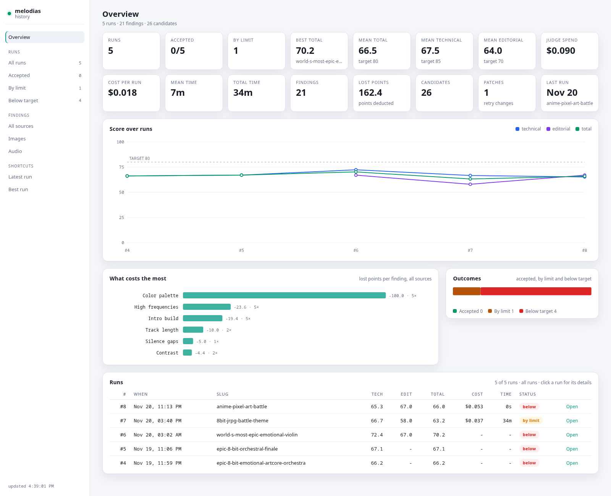
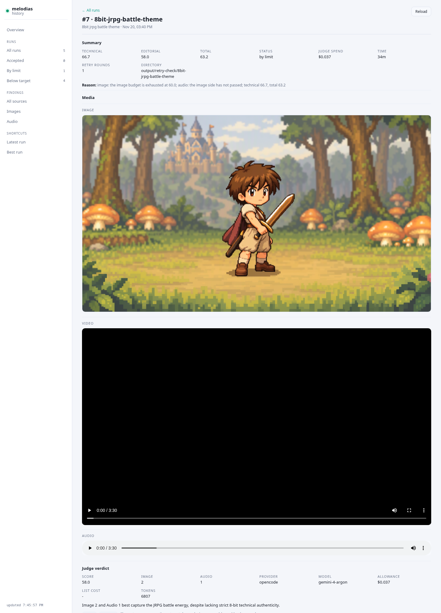

# Dashboard

The local, read-only dashboard over the history database. It shows the score
over runs, the findings that cost the most, the outcome mix and the run table,
with a left sidebar that filters the table and the findings chart.

## Screenshots



The home: totals, score trend, findings, outcomes and runs. The sidebar filters
runs by outcome and findings by source, and links to the latest and best run.



The run screen: summary, media, judge verdict, candidates, findings, patches,
files and the raw documents. It replaces the overview in the same page when you
click a row or open `?run=<id>`; `All runs`, `Escape` and the browser back button
return to the overview.

## Run it

```bash
make dashboard
# or
melodias dashboard [--port 7373] [--limit 200]
```

It binds `127.0.0.1`, opens the database read-only and polls the file once a
minute. `--port` changes the address and `--limit` the run window (200 by
default).

## What it reads

- `history.db`: runs, candidates, findings and applied patches.
- Every run directory under `OUT_DIR`: `meta.json`, `work/score.json`,
  `work/judge/verdict.json` and the images, audio and video.
- The run directory is resolved by slug, so a nested run such as
  `output/retry-check/<slug>/` also works.

## Endpoints

| Path | Purpose |
| --- | --- |
| `/api/summary?limit=N` | totals, the runs in the window and their findings |
| `/api/run?id=N` | one run: database row, candidates, findings, patches, `meta.json`, `score.json`, `verdict.json` and the artifact list |
| `/media/<run_id>/<path>` | an image, audio, video, JSON or text file inside that run, with HTTP byte ranges |

## Notes

- Read-only: it never writes the database or the run directory, and never
  creates a missing database.
- The static files are embedded with `include_str!`, so editing `index.html`,
  `app.js` or `style.css` needs a rebuild. There is no Node and no build step.
- Media URLs are confined to the run directory and limited to an allowlist of
  extensions.
- `?run=<id>` opens a run directly.

See [usage](../docs/usage.md#dashboard) for the command and
[configuration](../docs/configuration.md) for the database and output paths.
